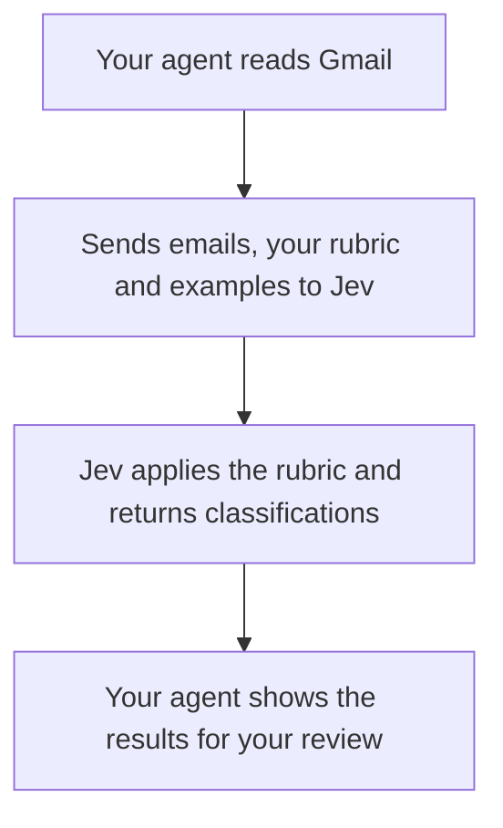

# Have your AI decide

Teach a simple email rubric through examples, then use Jev to apply it. Your coding agent handles Gmail and the workflow; you supply the judgment.

## How it works

Your agent checks and saves the results, then saves any corrections you make. Your inbox stays unchanged.

## Start here

Open this folder in Claude Code or Codex and paste the [setup prompt](START_HERE.md). You'll need a connected Gmail account, Python 3.11+ and a TypeSafe API key. Your agent can walk you through [setup](SETUP.md).

## Where to look

| File | What it's for |
| --- | --- |
| [rubric.example.json](rubric.example.json) | The starter rubric: Needs action, Worth seeing, Skip. |
| [examples/references.json](examples/references.json) | Gold and anti-gold examples showing the boundaries. |
| [.env.example](.env.example) | Copy to `.env` and add your Jev key locally. |
| [SETUP.md](SETUP.md) | Instructions your agent can follow to connect Gmail and Jev. |
| [pipeline.py](pipeline.py) | Apply the rubric to emails supplied by your agent and save results. |

Your approved rubric lives at **`local/my-review/rubric.json`**. Your approved examples live beside it in **`references.json`**. Ask your agent to open these when you want to review or change the judgment.

## Review and improve

Have your agent show all three categories in chat. Correct a decision and explain why; ask it to save the correction. Approve a teaching example separately if you want the distinction used on future emails. This changes what you send to Jev, not its model weights.

The [in-chat review interface](docs/inline-review.md) is included as an optional output. A numbered list or local review page works too. Jev returns categories, not written reasons; your coding agent can help discuss the original emails.

Skip leaves an email out of the attention list; it doesn't change your inbox. Ordinary bodies stay in memory. Private metadata and approved teaching examples stay in ignored `local/`; your host and TypeSafe have their own retention policies. [Storage details](docs/storage.md).

[Workflow chart](docs/workflow.md) · [Claude/Codex Gmail notes](docs/gmail.md) · [Rubric checks](docs/rubric-check.md) · [Schedule later](docs/scheduling.md) · [Verification](docs/verification.md)
