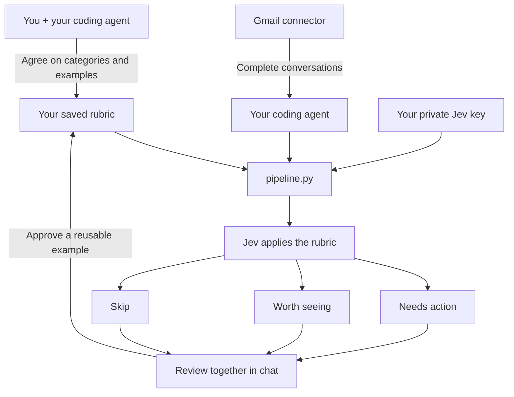

# The workflow

The in-chat review interface is optional. The same results can be shown as a numbered list or a local review page. A correction is saved for that email; a separately approved teaching example helps with future judgments.
